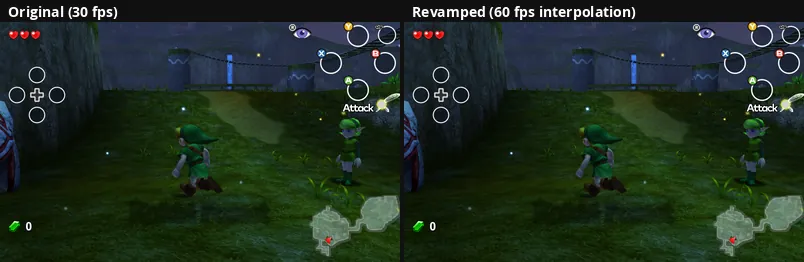
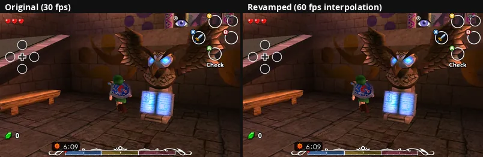
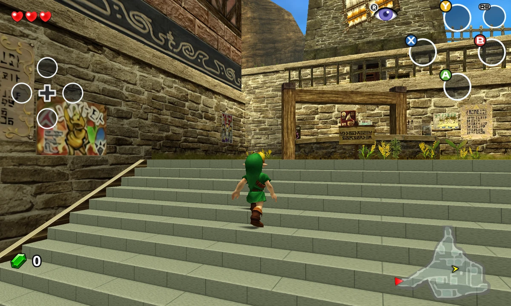
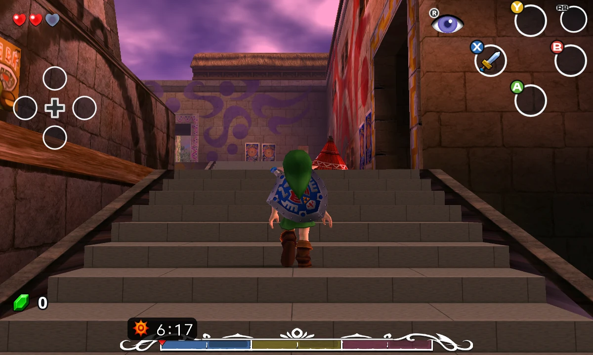

# Zelda 3D: Revamped

The Legend of Zelda: Ocarina of Time 3D and Majora's Mask 3D on one desktop app, `z3d`, built on
Azahar's core. It runs both games from your own dumps at 60 fps over their original 30 fps logic,
on one screen, with a press-Start cutscene skip, stepped 3D stairs and PC controls. A title picker
shows both games running side by side; pick one and it plays on without a reload.

Linux and macOS (Apple silicon) are released; Windows is in progress; Android is not built yet.

## Showcase

Captured from the app with each game's 4K texture pack.

*Kokiri Forest at half speed: the original (left) changes every other frame; the revamped side
(right) changes every frame, halfway between.*

*South Clock Town at half speed, original left, interpolated right.*

*Stepped stairs: the games' flat painted ramps drawn and walked as real steps.*

## Revamped Features

- **60 fps.** Each in-between frame is the game's own draw code run again with the camera,
  characters, limbs, fades and animated textures blended halfway, inside a sandbox that undoes its
  writes; the logic keeps its original rate. Scene changes, doors and cutscene shots are never
  blended across. "Frame interpolation" in each game's options, on by default.
- **Cutscene skip.** Start ends a skippable cutscene in the frame it is pressed, landing where
  watching it to the end would: the same flags, items, time and music.
- **Stepped stairs.** Painted ramps become stone steps with curb walls, or painted 3D steps where
  the texture is themed, in three sizes; the collision follows the steps.
- **One screen.** The game on a single screen with its touch-screen items and map in the HUD.
- **PC controls.** Keyboard, mouse and gamepads, with Xbox button glyphs; the mouse turns the camera
  and aims; a right-stick free camera in Ocarina of Time 3D.
- **Quick Text and autosave** after each scene change, each optional.
- **Title picker.** Both games running live side by side; each game's options on X.
- **Setup from your own files.** The app builds each game's set from your own dumps and your own
  downloads of the third-party mods it uses.

## Download

[The latest release](https://github.com/SomeoneIsWorking/zelda3d-revamped/releases/latest) has
z3d for Linux as one file, `z3d-x86_64.AppImage`, and for macOS on Apple silicon as
`z3d-macos-arm64.zip` (`z3d.app`): the app, our patches and the setup that builds each game from
your own dumps and your own downloads of the third-party mods. No game data and no
third-party mod is in it; the release notes say what to bring and where to get it.

Built with AI assistance (Claude and other LLMs).
